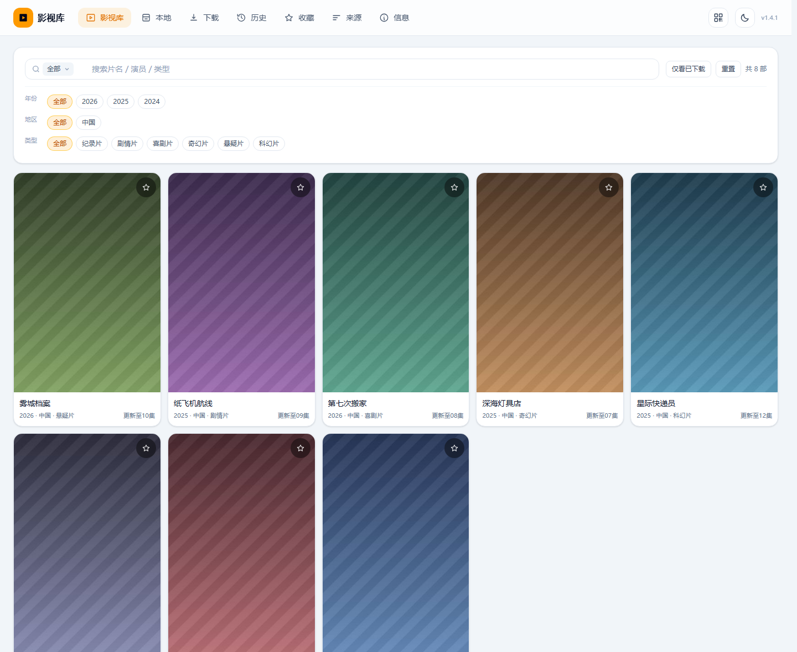
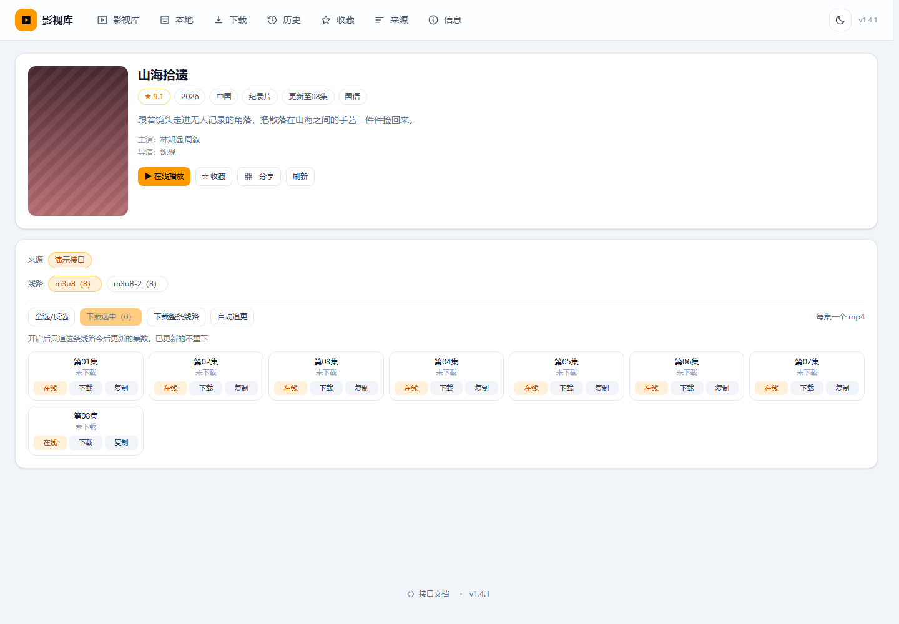
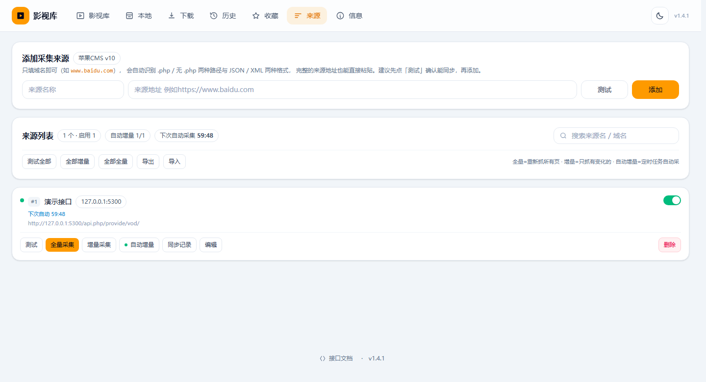
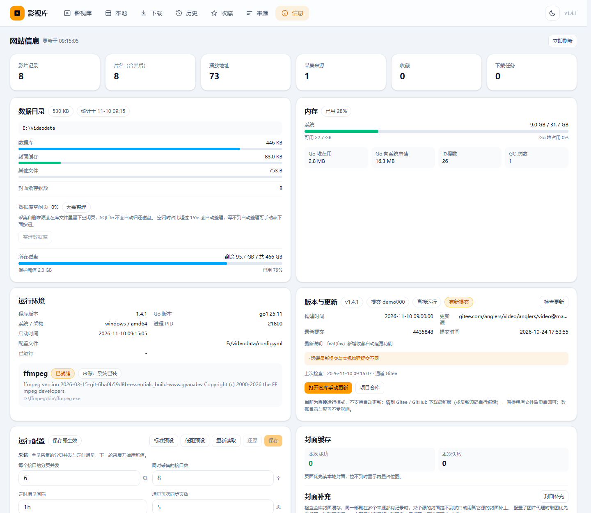
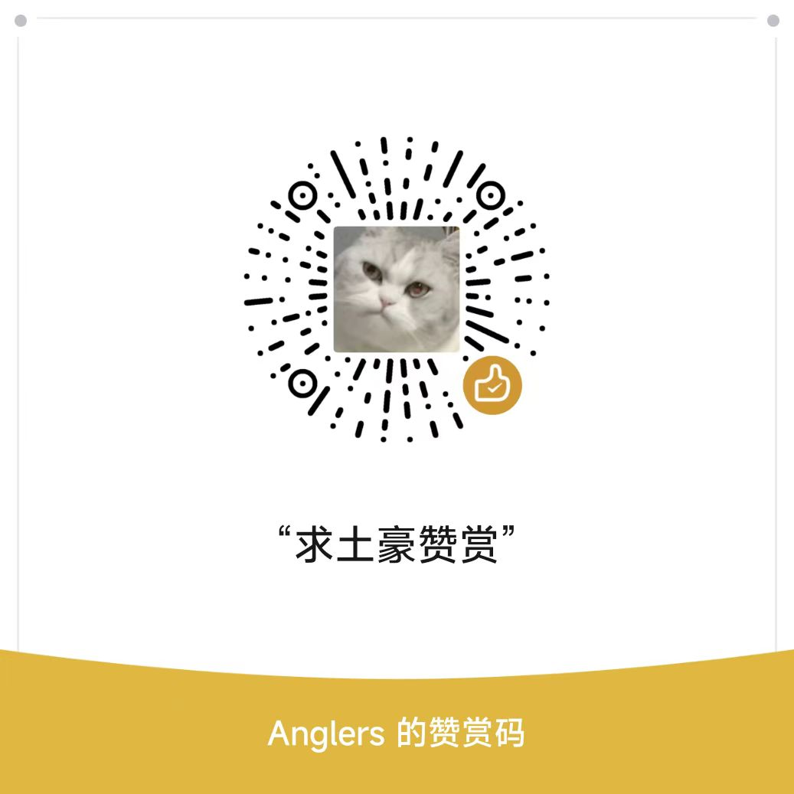

<div align="center">


# 影视库

自建影视资源采集、下载与播放的一体化服务。
单个二进制文件跑起来，片库、下载、播放记录全在自己的机器上。

<!-- 版本号与仓库根目录的 VERSION 文件保持一致 -->
[](https://github.com/AnglerS888/video/blob/main/VERSION)
[](https://gitee.com/anglers/video)
[](https://github.com/AnglerS888/video)


[功能](#功能) · [界面预览](#界面预览) · [安装](#安装) · [怎么用](#怎么用) · [在线更新](#在线更新) · [常见问题](#常见问题) · [关于作者](#关于作者)



<sub>接口采集来的片库，可以搜索、按类型筛选、只看已下载</sub>

</div>

## 功能

- **多接口采集** —— 添加任意数量的影视接口，只填域名，路径自动补全；全量可随时停止、断点续采
- **定时增量** —— 每小时只抓每个源最新的几页，自动发现新集
- **同名合并** —— 同一个剧在多个源都有时合成一条，详情页里按线路分组
- **在线播放** —— 服务端代理 HLS，绕开源站无 CORS、防盗链和伪装分片
- **下载** —— m3u8 分片并发拉取，ffmpeg 合并成 mp4，带进度、速度、暂停与续传
- **自动追更** —— 详情页给某部剧指定「来源 + 线路」，有新集自动进下载队列
- **局域网分享** —— 生成分享页链接和二维码，对方打开是网页，拿不到视频直链
- **访问密码** —— 可选，开了之后整站和接口都要密码

## 界面预览

**片库首页**


**详情页 · 多线路分集**



**来源管理 · 采集与同步记录**



**信息页 · 运行状态与在线更新**



> 截图里的片名、封面都是程序生成的演示数据，不涉及任何真实影视内容。

## 安装

装好后浏览器打开 `http://服务器IP:5200/`。程序本身**不内置任何采集接口**，片源要自己添加。

### 方式一：一键部署（Linux + Docker，推荐）

按服务器所在网络选一条，脚本会自动下载源码、构建镜像、启动容器：

```bash
# 国内服务器（Gitee 源）
curl -fsSL https://gitee.com/anglers/video/raw/master/deploy.sh | bash

# 国外 / 能直连 GitHub 的机器
curl -fsSL https://raw.githubusercontent.com/AnglerS888/video/main/deploy.sh | bash
```

脚本会询问对外端口和数据目录。**再执行一次就是升级**。常用参数：

```bash
bash deploy.sh --port 8080 --data /data/videodl   # 换端口 / 换数据目录
bash deploy.sh --source github                    # 指定从哪个仓库拉源码
bash deploy.sh --yes                              # 全用默认值，不交互
```

默认按 **Gitee → GitHub** 顺序试，哪个能下用哪个。

### 方式二：Docker Compose

```bash
git clone https://gitee.com/anglers/video.git    # 或 github.com/AnglerS888/video.git
cd video
docker compose up -d --build
```

### 方式三：直接运行

需要 Go 1.26+。编译出来一个可执行文件即可，不用装数据库：

```bash
go build -o videodl .
./videodl                      # 首次运行会在当前目录生成 config.yml
```

Windows 直接双击 `videodl.exe` 也行，默认 `:5200`。端口、数据目录在 `config.yml` 里改。

## 怎么用

1. **添加接口** —— 进「来源」页，填接口域名就行（比如 `https://example.com`），路径会自动补成
   `/api.php/provide/vod/`。要求对方是标准苹果 CMS v10 接口。
2. **采集** —— 点「全量采集」把片库同步下来。可以随时停，下次接着采；之后开启「自动增量」每小时自动追新。
3. **逛片库** —— 首页搜索支持按片名 / 演员切换，右侧可按类型筛选，「只看已下载」能过滤出本地已有的。
4. **播放和下载** —— 详情页点「在线播放」边下边播；点某集的「下载」进下载队列，
   完成后在「本地」页按剧分组管理，支持续播和自动下一集。
5. **追更** —— 详情页选好来源和线路，打开「自动追更」，这条线路以后出的新集会自动下载。
6. **分享** —— 首页右上角生成二维码，或详情页点「分享」生成带令牌的分享页链接，只能在线看，不给文件。
7. **加密码（可选）** —— 「信息」→「运行配置」里设个密码，保存即生效。

## 在线更新

Docker 部署的，进「信息」页 →「版本与更新」：

- 点「检查更新」会同时查 Gitee 和 GitHub，**取版本号更新的那个**；
- 有新版本点「立即更新」，会在容器里下载源码、编译并替换，然后自动重启（数据不动）；
- 源码包下载失败会自动换另一个仓库重试；
- 版本号没变但想重装，用「强制更新」。

> 直接运行（裸二进制）不支持在线更新，页面上只给仓库地址，自己下载替换。

## 常见问题

**添加接口失败？**
接口必须是苹果 CMS v10 的 `api.php/provide/vod/` 格式，且外网可访问。只填域名即可，不用写完整路径。

**下载一直不动？**
看「信息」页的「运行配置 → 下载」：并发数太大、磁盘剩余空间低于保护阈值都会让它暂停。
磁盘不够时新任务会直接拒绝入队。

**数据在哪？怎么备份？**
数据目录（Docker 部署时脚本会问，默认当前目录下的 `videodata`）里的 `videodl.db` 和 `videos/`。
停机后把整个目录拷走，放到新机器同样的位置启动即可。

**封面显示不出来？**
部分源站有防盗链。程序会把封面抓到本地，抓不到时显示内置占位图，不影响播放。

## 关于作者

- **作者微信**：`KFC_good` —— 使用问题、部署求助、功能定制都可以加，备注一下「影视库」即可。
- 如果这个项目帮到了你，欢迎请作者喝杯咖啡：

<div align="center">



<sub>Anglers 的赞赏码</sub>

</div>

## 说明

- 程序不提供、也不预置任何片源，所有接口由使用者自行添加。
- 请只在合法范围内使用，片源内容的版权与合规责任由使用者自负。

<div align="center">

[Gitee](https://gitee.com/anglers/video) · [GitHub](https://github.com/AnglerS888/video)

</div>
